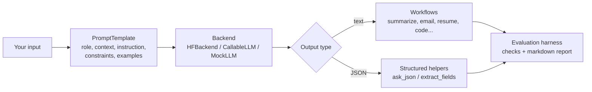

<div align="center">

# PromptCraft: AI Productivity Toolkit

**Reusable prompt templates, reliable JSON output, ready-made workflows and a prompt-testing harness for any LLM.**


</div>

---

## Why this project exists

Most people write a prompt once, eyeball one answer and move on. That does not scale: the same prompt behaves differently across inputs and models, and nobody can tell whether a change made it better or worse.

**AI Productivity Toolkit treats prompts like code.** They are structured, reusable, validated and tested.

| Problem | What the toolkit gives you |
|---------|---------------------------|
| Prompts are copy-pasted strings | `PromptTemplate` with separate role, context, instruction, constraints and examples |
| Models do not follow a label set or format | Few-shot templates and label normalisation |
| Small models break JSON | `ask_json` (validate and retry) and `extract_fields` (always valid JSON) |
| "Is this prompt better?" is a guess | `run_suite`, `compare_prompts` and an auto-generated markdown test report |
| Locked to one model or API | Any object with `generate(prompt)` works |

## Features

- **Prompt templates**: role, context, instruction, constraints and examples are separate fields. Turn any template into few-shot with `.with_examples(...)`.
- **Structured outputs**
  - `extract_json`: finds a JSON object inside noisy model text (code fences, extra sentences).
  - `ask_json`: asks for JSON, validates required keys and retries with a corrective prompt.
  - `extract_fields`: asks one question per field and builds the JSON itself, so the result is always valid. Best for small models.
- **Productivity workflows**: `summarize`, `classify`, `write_email`, `improve_resume_bullet`, `explain_code`, `debug_code`, `research_outline`.
- **Evaluation**: `TestCase`, `run_suite`, `compare_prompts`, check helpers (`max_words`, `contains_any`, `equals_label`, `valid_json_with`) and `to_markdown` for a shareable testing report.
- **Model-agnostic backends**: `HFBackend` (free Hugging Face model), `CallableLLM` (wrap any API) and `MockLLM` (offline tests).
- **Command line tool**: `python -m ai_productivity_toolkit summarize "..."`.
- **Zero core dependencies.** `transformers` and `torch` are needed only for `HFBackend`.

## Architecture



Every part talks to the model only through `llm.generate(prompt, **kwargs)`. That single seam is what makes the toolkit testable offline and portable across models.

## Installation

```bash
git clone https://github.com/<your-username>/PromptCraft-AI-Productivity-Toolkit.git
cd PromptCraft-AI-Productivity-Toolkit

pip install -e .            # core toolkit, no dependencies
pip install -e ".[hf]"      # plus transformers and torch for HFBackend
```

Requires Python 3.9 or newer.

## Quick start

```python
from ai_productivity_toolkit import HFBackend, summarize, classify, extract_fields, write_email

llm = HFBackend("google/flan-t5-base")   # free model, runs on CPU

print(summarize(llm, "Your long text ...", style="2 bullet points", max_words=40))

print(classify(
    llm, "The package arrived broken.", ["complaint", "praise", "question"],
    examples=[("Thanks, great help!", "praise"), ("Where is my order?", "question")],
))

print(extract_fields(llm, "I am Sara from Karachi.",
                     {"name": "What is the name?", "city": "Which city?"}))

print(write_email(llm, "ask for a deadline extension", recipient="my manager",
                  points=["two extra days", "quality will improve"]))
```

### Command line

```bash
python -m ai_productivity_toolkit summarize "Long text here" --style "one sentence"
python -m ai_productivity_toolkit classify "Great service!" --labels positive,negative,neutral
python -m ai_productivity_toolkit email "ask for a deadline extension" --to "my manager" --point "two extra days"
python -m ai_productivity_toolkit resume "helped with a website project" --role "Web Developer"
python -m ai_productivity_toolkit debug "def add(a,b): return a-b" --error "add(2,3) returned -1"
python -m ai_productivity_toolkit research "Effects of remote work on productivity"

# Offline check of the plumbing, no model download:
python -m ai_productivity_toolkit --mock summarize "hello world"
```

## What a template produces

Templates are plain text, so you can see exactly what the model receives.

```python
from ai_productivity_toolkit import SUMMARIZE
print(SUMMARIZE.render(input="Remote work saves commuting time but makes spontaneous talks harder.",
                       style="one sentence", max_words=20))
```

```text
Role: You are a careful editor.

Task: Summarize the text below as one sentence.

Constraints:
- Use at most 20 words.
- Do not add facts that are not in the text.

Text: Remote work saves commuting time but makes spontaneous talks harder.
Summary:
```

Few-shot version (`CLASSIFY.with_examples([...])`):

```text
Task: Classify the text into exactly one label from: complaint, praise, question.

Constraints:
- Answer with the label only.

Text: Thanks, great help!
Label: praise

Text: Where is my order?
Label: question

Text: The package arrived broken.
Label:
```

## Create your own template

```python
from ai_productivity_toolkit import PromptTemplate

tweet = PromptTemplate(
    name="tweet",
    role="You are a social media writer.",
    instruction="Write a tweet about: {topic}",
    constraints=["Max 30 words", "Add 2 hashtags"],
)
prompt = tweet.render(input="", topic="learning prompt engineering")
```

## Test your prompts

```python
from ai_productivity_toolkit import TestCase, run_suite, to_markdown, contains_any, max_words

cases = [
    TestCase("short enough", prompt, max_words(30), "<= 30 words"),
    TestCase("has hashtag", prompt, contains_any("#"), "contains #"),
]
results = run_suite(llm, cases)
open("reports/testing_report.md", "w").write(to_markdown(results, backend_name=llm.name))
```

Compare several wordings of the same task and see which passes:

```python
from ai_productivity_toolkit import compare_prompts, max_words

compare_prompts(llm, {
    "bare":        f"Summarize: {text}",
    "constrained": f"Summarize in one sentence of at most 20 words: {text}",
}, check=max_words(25))
```

## Use any model or API

```python
from ai_productivity_toolkit import CallableLLM

def call_my_model(prompt: str, **kwargs) -> str:
    ...  # call OpenAI, Anthropic, a local server, anything
    return "model reply"

llm = CallableLLM(call_my_model, name="my-model")
```

Every workflow, the JSON helpers and the test harness work unchanged.

## Project structure

```text
PromptCraft-AI-Productivity-Toolkit/
├── ai_productivity_toolkit/
│   ├── backends.py       HFBackend, CallableLLM, MockLLM
│   ├── templates.py      PromptTemplate (zero-shot and few-shot)
│   ├── structured.py     extract_json, ask_json, extract_fields
│   ├── workflows.py      summarize, classify, email, resume, code, research
│   ├── evaluation.py     TestCase, run_suite, compare_prompts, to_markdown
│   └── cli.py            command line interface
├── tests/                19 offline unit tests (no model needed)
├── examples/             quickstart, full demo, custom template
├── notebooks/            Google Colab notebook with all experiments
├── docs/prompt_patterns.md   cheat sheet of reusable prompt patterns
├── reports/              generated prompt testing reports
└── .github/workflows/ci.yml  runs tests on Python 3.9, 3.11, 3.12
```

## Running the tests

```bash
python -m unittest discover -s tests -v
```

All tests use `MockLLM`, so they run in milliseconds and need no internet, GPU or API key. The same suite runs on every push through GitHub Actions.

## Notebook

`notebooks/AI_Productivity_Toolkit.ipynb` is a Colab notebook that walks through every module objective: zero-shot vs few-shot, role and constraint experiments, JSON extraction, summarization and classification, code explanation and debugging, a test suite with a generated report, and the complete toolkit. Open it in Google Colab and choose **Runtime, Run all**.

## Design decisions

- **One seam to the model.** All code calls `llm.generate(prompt, **kwargs)`, so swapping models never touches workflows.
- **Never trust JSON from a model.** Outputs are validated and retried, or assembled field by field so they cannot be malformed.
- **Single-pass placeholder filling.** Templates substitute `{name}` placeholders in one pass, so code or JSON containing braces inside user input is not misread as a placeholder.
- **Tests without a model.** `MockLLM` makes logic testable offline and keeps CI fast and free.

## Limitations

- The default `google/flan-t5-base` model is small. Summarization, classification and field extraction work well; long-form text (emails, resume rewrites, code review) is basic. Use `CallableLLM` with a stronger model for better quality, no other code changes needed.
- Automatic checks (length, keywords, label, JSON keys) catch format problems, not every quality problem. Review outputs by eye as well.
- Label matching is fuzzy and returns `unknown` when nothing fits, which is intentional.

## Roadmap

- Built-in backends for popular hosted APIs
- Template library export and import (YAML or JSON)
- Scoring with an LLM-as-judge check
- Cost and latency columns in the test report

## Contributing

Issues and pull requests are welcome. Please run `python -m unittest discover -s tests` before opening a PR and add a test for new behaviour.

## License

MIT. See [LICENSE](LICENSE).

---

Built as the Module 02 project (Prompt Engineering and AI Productivity) of the Codomax Digital Solutions AI internship.
